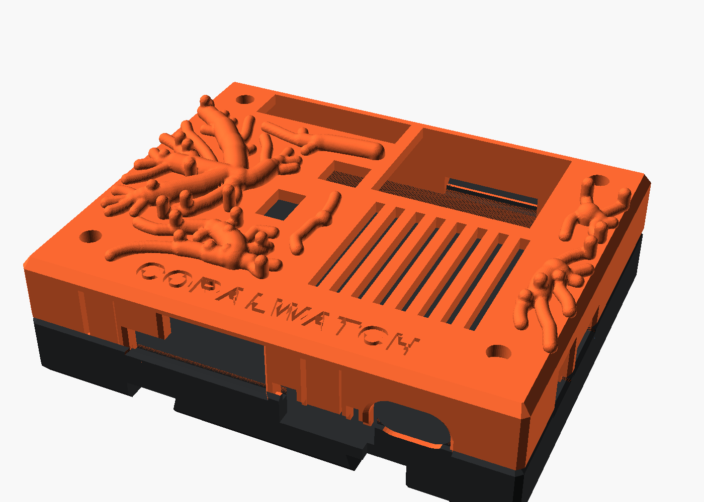
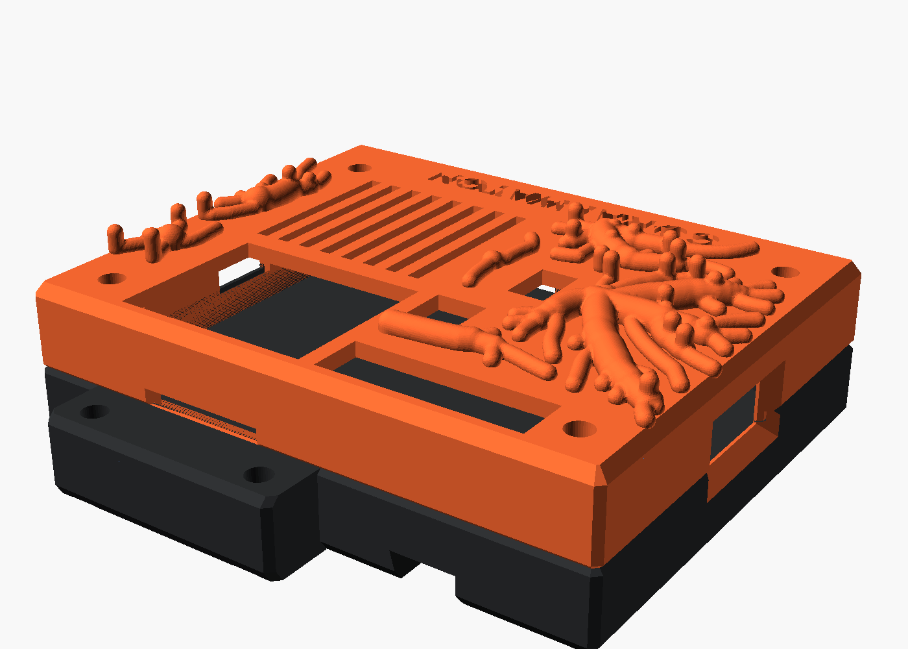
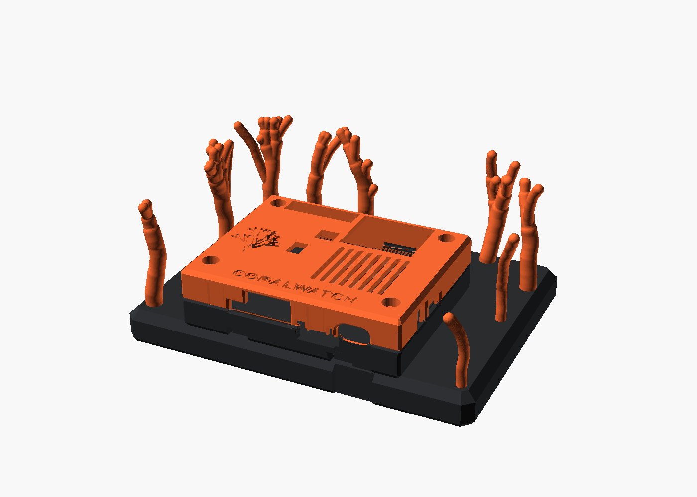
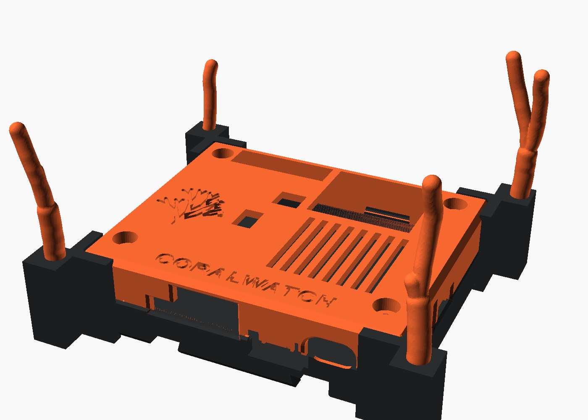

# coralgen

Grows coral onto an existing 3D-printable part, so that the result still prints **without supports**.



You give it a part (STL, in its print orientation), the volumes the coral must leave free (ports,
screw heads, vents, a lid's lift path...) and a TOML config. It grows a coral skeleton, turns it into
a smooth solid, fuses it with the part and then **slices the result in PrusaSlicer** with your
printer profile: a result counts only if the coral adds no support material.

## Coral shapes

| `envelope.shape` | What grows | Example |
|---|---|---|
| `crawl` | coral creeping over the part's surface, around obstacles, pouring over edges and down the sides | `examples/coral/coral_lid_crawl.toml` |
| `branching` | recursive colonies standing up from the part: flat sea fans (`fork_twist_deg = 0`) or bushy staghorns (`90`) | `examples/coral/reef_stand.toml` |
| `volume` | space colonisation (Runions et al. 2007) towards attractors that fill an envelope | `examples/coral/case_base.toml` |

| Creeping over a lid | Standing on a reef stand | Snap-on corner clips |
|---|---|---|
|  |  |  |

## Why it prints without supports

The rules are built into the growth, then checked by slicing:

- Every free-standing segment points upwards within `growth.max_tilt_deg` of vertical (40 deg by
  default; with the Prusa MINI+ profile 50 deg wedges still slice without support).
- A creeping branch lies half-sunk on the surface (axis `crawl.center_height_ratio` radii above it).
  On a top face it may run anywhere; on faces steeper than the tilt cone it may only run downwards,
  so a run over an edge never has a hanging low point, whichever way up its piece is printed.
- Branch ends on steep faces must point up in the print frame of their piece, or they are pruned.
- Unrelated branches keep a gap (`growth.branch_gap`) so they are never bridged by a thin web.
- Roots are anchored: each root continues into the part, and its whole cross-section rests on
  material (not over an edge or chamfer).
- Branches are united with a plain minimum of capsule distance fields: a smooth minimum swells
  every joint into a ring bulge, which is an overhang on a branch's underside.
- The result can be cut into printed pieces (`[[part]]` with `z_min`, `z_max`, `flip`), e.g. a lid
  plate printed flat and a lid ring printed upside down; every piece is verified on its own.

## Install

Python 3.12 and [uv](https://docs.astral.sh/uv/):

```sh
uv sync
```

Verification needs `prusa-slicer` on `PATH` and a PrusaSlicer vendor bundle with your system presets
(`~/.config/PrusaSlicer/vendor/PrusaResearch.ini` after PrusaSlicer has run once). The presets are
named in `[verify]`; the bundle's inheritance is resolved into one config for the CLI.

## Use

```sh
cd examples/coral
uv run coralgen grow   coral_lid_crawl.toml   # skeleton JSON + low-poly preview STL, seconds
uv run coralgen mesh   coral_lid_crawl.toml   # full solid: STL + 3MF, coral-only STL, [[part]] pieces
uv run coralgen verify coral_lid_crawl.toml   # PrusaSlicer: exit 1 if the coral adds support
uv run coralgen build  coral_lid_crawl.toml   # all three
uv run coralgen search coral_lid_crawl.toml   # build seed after seed (verify.max_attempts) until one passes
```

Outputs go to `out/` next to the config, with a JSON report of every step and search attempt.
Every config key is required; a missing or unknown key is an error, there are no hidden defaults.
`coralgen grow` explains an impossible setup filter by filter, e.g. how many root candidates
survived the keep-out, the height band and the anchoring rule.

## Examples

`examples/` holds a case for the Synaptics Coralboard SL (`examples/case/case.scad`) and three ways to
put coral on it (`examples/coral/*.scad`, OpenSCAD), each with the input STLs in `examples/stl/` and
the commands to regenerate them in the header of its config:

- **Coral lid** (`coral_lid.scad`): the lid split into a ring (prints upside down like a normal lid)
  and a flat top plate; a one-piece lid printed top-up would need a 74 x 59 mm ceiling bridge.
  `coral_lid_crawl.toml` lets coral creep over the whole lid; `coral_lid.toml` grows colonies from the
  plate.
- **Reef stand** (`reef_stand.scad`): a desk stand; the case drops in from above onto guide ridges in
  its C-Rail channels and a key in the latch groove.
- **Corner clips** (`coral_clips.scad`): four snap-on clips around the closed case, coral on posts.
- `case_base.toml` is kept as a record of a host with no room for coral: the generator explains why.

`case.scad` imports the official board model only for assembly renders; get
`Synaptics_CoralBoard_SL.stl` (Apache 2.0) from https://www.printables.com/@Google_Coral (model
1859306) and place it in the repository root if you want those renders.

## Tests

```sh
uv run python -m unittest discover -s tests -v
```

The end-to-end tests grow and mesh coral on a synthetic part and slice it with PrusaSlicer, including
a check that the gate fails an obviously unsupported cantilever.

## Status

Experimental. The coral lid, reef stand and corner clip examples pass the PrusaSlicer check with the
Prusa MINI+ IS presets; none has been printed yet.

## License

MIT, see `LICENSE`.
